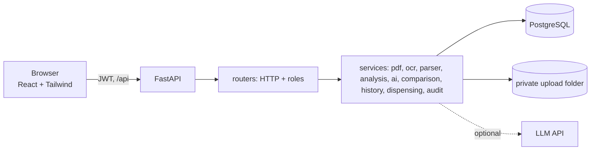
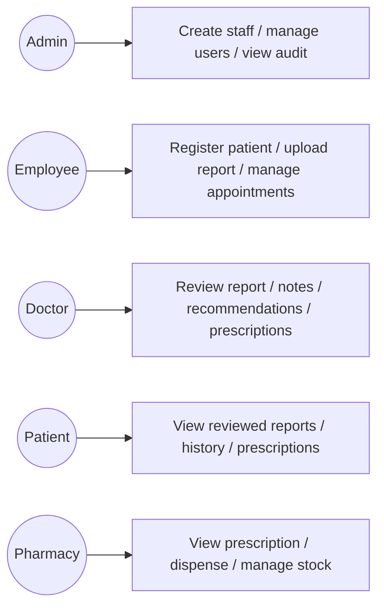
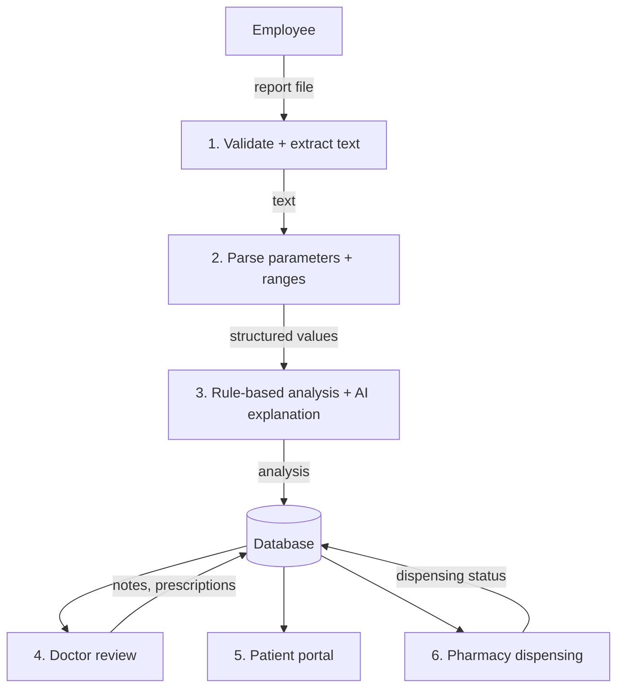
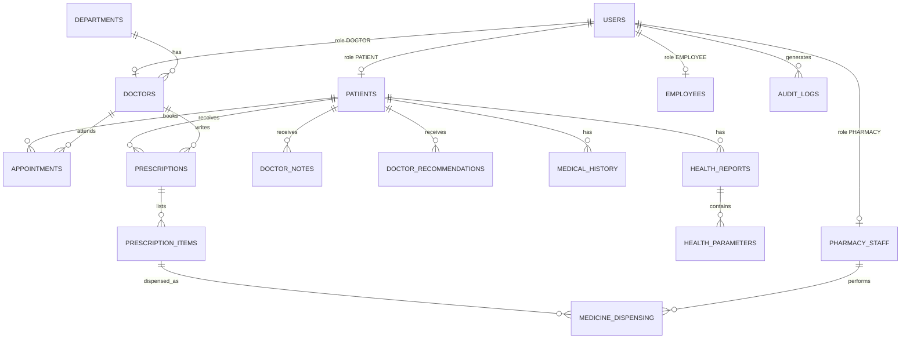
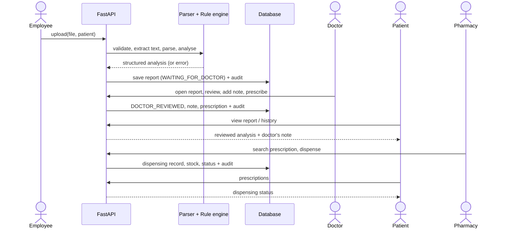
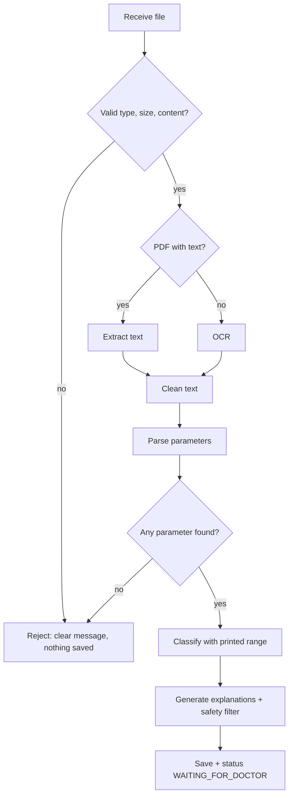
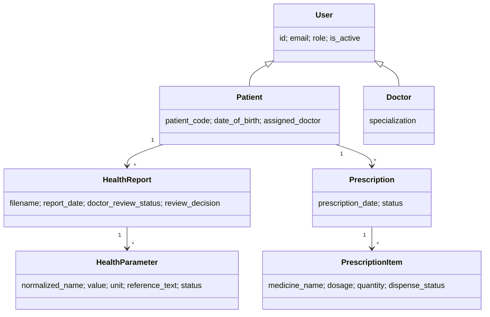

# HealthWise AI: Project Report Material

Use this as the skeleton of your final-year report. Diagrams are written in Mermaid (render them in VS Code with a Mermaid preview extension, or on mermaid.live, then paste as images).

## Project title
HealthWise AI: AI-Powered Hospital Management and Patient Health Report Analysis & History Tracking System.

## Abstract
HealthWise AI is a web-based hospital management system in which laboratory reports are uploaded, actually read (PDF text extraction or OCR), converted into structured values and compared with the reference ranges printed in the report using deterministic rules. An AI component only explains the results in simple language. Every analysis is reviewed by a doctor, who adds clinical notes, recommendations and prescriptions. Patients see the reviewed result and a chronological health history; the pharmacy dispenses against valid prescriptions; administrators monitor the hospital through dashboards and an audit log. Five roles are protected by role-based access control.

## Problem statement
Hospitals receive laboratory reports as PDFs or photos. Doctors read raw numbers manually, patients find them hard to understand, history is scattered across files, and there is no single trusted path from report to prescription to dispensing.

## Existing system and limitations
Paper files or separate PDF folders; manual reading of reports; no combined history; no comparison across reports; prescriptions and dispensing tracked separately; weak access control and no audit trail.

## Proposed system
One platform where: the employee uploads a report -> the system extracts and analyses it -> the doctor reviews and acts -> the patient and pharmacy see exactly what they are allowed to see -> everything is recorded in a patient timeline and audit log.

## Objectives
1. Extract real values from uploaded reports. 2. Classify values using the report's own reference range. 3. Keep the doctor as the final authority. 4. Provide role-based access and privacy. 5. Maintain complete patient history with comparison and trends. 6. Connect prescriptions to pharmacy dispensing. 7. Record an audit trail.

## Scope
Hospital workflow for reports, review, prescriptions, dispensing, appointments and history. Not in scope: diagnosis, disease prediction, medicine suggestion, billing.

## User roles
Admin, Doctor, Hospital Employee, Patient, Pharmacy staff (permission matrix in [ARCHITECTURE.md](ARCHITECTURE.md)).

## Functional and non-functional requirements
See [SRS.md](SRS.md) (FR-01 to FR-32, traceability matrix).

## System architecture

## Use case diagram

## Data flow diagram (level 1)

## ER diagram

## Sequence diagram: report to prescription

## Activity diagram: report processing

## Class diagram (main entities)

## Technology stack
FastAPI, SQLAlchemy, Pydantic, PostgreSQL/SQLite, JWT, bcrypt, pypdf, pypdfium2, Pillow, Tesseract, React, Vite, Tailwind, Recharts, Docker.

## AI methodology (hybrid)
Deterministic code extracts and classifies. An optional LLM rewrites explanations from validated facts only; a safety filter blocks diagnosis, prescription, dosage, guarantee and similar language and falls back to templates. Doctor review is mandatory before a patient sees analysis.

## OCR methodology
PDFs: try the text layer first; if there is too little text, render pages to images. Images: grayscale, upscale, contrast, denoise, then Tesseract (page segmentation mode 6, suited to lab tables). OCR text goes through the same parser.

## Report analysis algorithm
1. Clean text. 2. For each line, match a known test name (alias table) at the line start. 3. Read value, unit, then the reference range (a-b, <x, >x) from the same or following lines; reject lines where text between name and value is not harmless (avoids "Cholesterol/HDL ratio" being read as cholesterol). 4. Normalize names. 5. Status: below low bound -> BELOW, above high bound -> ABOVE, inside -> WITHIN, no range -> UNKNOWN. 6. Save only if at least one parameter was found.

## Role-based access control
JWT identifies the user; the role is read from the database on every request (so deactivation works). `require_roles` limits endpoints by role; `get_accessible_patient` and report/prescription checks limit records per user.

## Testing strategy
61 automated tests: unit tests (parser, ranges, rules, safety filter), API tests per role and endpoint, access-control tests for every rule in the matrix, and one end-to-end test of the complete hospital workflow.

## Results
The complete workflow runs end to end with real files: different reports give different extracted values; invalid files are rejected; the patient sees analysis only after doctor review; dispensing updates prescription status and stock; every step is audited.

## Limitations
Numeric results only; limited parameter catalogue; OCR depends on scan quality; no email password reset or token blacklist; simple stock model.

## Future scope
Mobile app, telemedicine, online booking, lab/insurance/billing integration, e-signature for prescriptions, multilingual support, voice assistant, hospital analytics.

## Conclusion
HealthWise AI shows how AI can assist, but not replace, clinicians: automation handles extraction and explanation, and role-controlled workflows keep the doctor responsible for every clinical decision.

## References
FastAPI docs; SQLAlchemy docs; React docs; Tesseract OCR; pypdf; OWASP password storage and access-control guidance; relevant medical-informatics literature chosen by the student.
